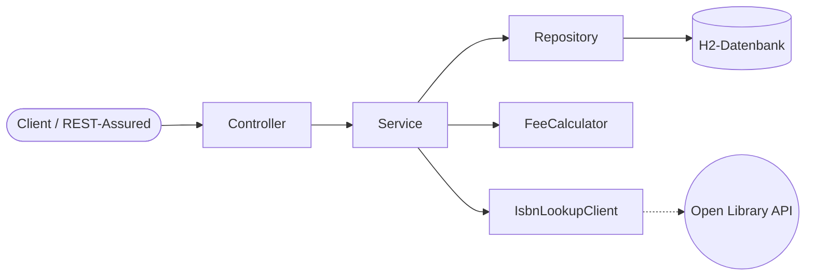
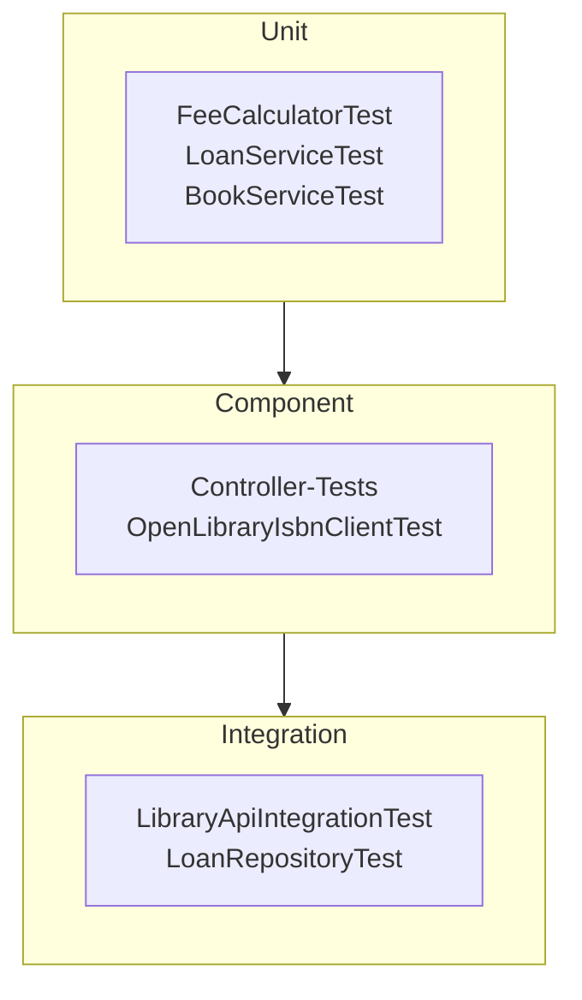

# Dokumentation – Library

## Inhalt

1. [Planung](#planung)
2. [Architektur](#architektur)
3. [Testkonzept](#testkonzept)
4. [TDD im Projekt](#tdd-im-projekt)
5. [Reflexion über TDD und Code Reviews](#reflexion-über-tdd-und-code-reviews)
6. [Auswertung und Ideen für die Zukunft](#auswertung-und-ideen-für-die-zukunft)

---

## Planung

Verfügbare Zeit: eine Woche. Der Umfang ist bewusst klein gehalten, damit die Testkriterien sauber umgesetzt werden können, statt viel Funktionalität mit dünner Testabdeckung zu liefern.

| Schritt | Inhalt | Ergebnis |
|---|---|---|
| 1 | Projektidee, Umfang, Geschäftsregeln festlegen | Bibliotheksverwaltung, ein Backend ohne Frontend |
| 2 | Projektgerüst, TDD für die Mahngebühren | `FeeCalculator` mit Grenzwerttests |
| 3 | Services mit Mockito testen | Ausleih- und Buchlogik |
| 4 | Controller, ISBN-Schnittstelle (WireMock) | Component-Tests |
| 5 | Integrationstests mit echter Datenbank | REST-Assured-Tests, Repository-Test |
| 6 | Pipeline und Reports | GitHub Actions, GitHub Pages |
| 7 | Dokumentation, Pull Requests, Präsentation | Dieses Dokument |

Bewusst **nicht** umgesetzt (Scope): Frontend, Authentifizierung, Vormerkungen, persistente Datenbank.

## Architektur

| Schicht | Klassen | Aufgabe |
|---|---|---|
| Controller | `BookController`, `MemberController`, `LoanController` | HTTP, Validierung, Statuscodes |
| Service | `BookService`, `MemberService`, `LoanService`, `FeeCalculator` | Geschäftsregeln |
| Repository | `BookRepository`, `MemberRepository`, `LoanRepository` | Datenzugriff (Spring Data JPA) |
| Client | `IsbnLookupClient` (Interface), `OpenLibraryIsbnClient` | Externe Schnittstelle |
| Exception | `NotFound-`, `Conflict-`, `ExternalServiceException`, `ApiExceptionHandler` | Übersetzt Fehler in 404, 409, 502, 400 |

Entwurfsentscheide, die das Testen erleichtern:
- **Der externe Dienst steht hinter einem Interface** (`IsbnLookupClient`). Dadurch lässt er sich in Unit-Tests mit Mockito und in Integrationstests mit `@MockitoBean` ersetzen.
- **Die Uhr ist ein Bean** (`java.time.Clock`). Tests setzen sie auf ein festes Datum, damit das Rückgabedatum vorhersehbar ist.
- **Die Mahngebühr ist eine eigene Klasse** ohne Abhängigkeiten. Sie lässt sich ohne Spring und ohne Mocks testen.

## Testkonzept

### Ziel
Sicherstellen, dass die Geschäftsregeln der Bibliothek korrekt umgesetzt sind und die REST-Schnittstelle bei gültigen und ungültigen Eingaben das spezifizierte Verhalten zeigt.

### Testobjekte
Mahngebühr-Berechnung, Ausleih- und Rückgabelogik, Buchverwaltung mit ISBN-Lookup, REST-Controller inklusive Validierung und Fehlerbehandlung, Datenzugriff.

### Teststufen und Methoden
| Stufe | Methode | Anzahl Tests | Mocking |
|---|---|---|---|
| Unit | White-Box, automatisiert (JUnit 5) | 27 | Mockito: Repositories, `FeeCalculator`, ISBN-Client |
| Component | White-Box, automatisiert | 20 | `@MockitoBean` für Services, WireMock für die externe API |
| Integration | Black-Box über HTTP (REST-Assured) und Repository-Test | 11 | Nur der ISBN-Dienst |

Nicht-funktionale Tests (Last, Sicherheit) sind für diesen Umfang nicht vorgesehen.

### Testumgebung
Java 21, Maven, H2-In-Memory-Datenbank, lokal und in der GitHub-Actions-Pipeline (Ubuntu). Es braucht keine externen Systeme, auch die Open-Library-API wird in den Tests ersetzt.

### Testdaten
Jeder Test legt seine Daten selbst an. Die Integrationstests leeren die Datenbank vor jedem Test (`@BeforeEach`), damit die Reihenfolge keine Rolle spielt.

### Ausgewählte Testfälle (Grenzwerte)
| Bereich | Fall | Erwartet |
|---|---|---|
| Mahngebühr | 0 Tage / früher | CHF 0.00 |
| Mahngebühr | 1 Tag, 7 Tage | CHF 2.00 |
| Mahngebühr | 8 Tage, 14 Tage | CHF 5.00 |
| Mahngebühr | 15 Tage, 100 Tage | CHF 10.00 |
| Ausleihlimit | 2 aktive Ausleihen | Ausleihe erlaubt |
| Ausleihlimit | 3 oder 4 aktive Ausleihen | 409, nichts wird gespeichert |
| Ausleihen | Buch bereits ausgeliehen | 409 |
| Rückgabe | Zweimal zurückgeben | 409 |
| ISBN-Lookup | Titel angegeben | Dienst wird **nicht** aufgerufen |
| ISBN-Lookup | Titel leer / `null` / Leerzeichen | Dienst wird aufgerufen |
| ISBN-Lookup | ISBN unbekannt | 404, nichts wird gespeichert |
| ISBN-Lookup | Dienst antwortet mit 500 | 502 |
| Validierung | Ungültige Email, leerer Name, fehlende ID | 400 mit Feldmeldung |

### Erfolgskriterien
- Alle Tests bestehen.
- Zeilenabdeckung mindestens 80 % (wird in der Pipeline erzwungen).
- Pipeline auf `main` ist grün und veröffentlicht die Reports.

### Reporting
Surefire-Report (Testresultate) und JaCoCo-Report (Coverage) als HTML, in der Pipeline als Artefakt und auf GitHub Pages. Zusätzlich zeigt die Pipeline die Testresultate als Check-Run beim Commit.

### Risiken
| Risiko | Massnahme |
|---|---|
| Externe API ändert ihr Format | Component-Test mit WireMock dokumentiert das erwartete Format |
| Tests hängen von der Reihenfolge ab | Datenbank wird vor jedem Integrationstest geleert |
| Tests hängen vom aktuellen Datum ab | Uhr als Bean, in Unit-Tests fest eingestellt |

## TDD im Projekt

Die Mahngebühr-Berechnung (`FeeCalculator`) wurde testgetrieben entwickelt, in drei Runden Red, Green, Refactor:

| Runde | Red (Test zuerst) | Green (minimaler Code) | Refactor |
|---|---|---|---|
| 1 | Zwei Tests «pünktlich oder früher kostet nichts». Build schlägt fehl, weil `FeeCalculator` noch nicht existiert. | Klasse mit `return 0.00` | – |
| 2 | Test wird parametrisiert und um 1, 7, 8 und 14 Tage ergänzt. **4 von 6 Fällen rot** (`expected: <2.00> but was: <0.00>`). | `if`-Stufen für Woche 1 und 2 | – |
| 3 | 15 und 100 Tage ergänzt. **2 von 8 Fällen rot** (`expected: <10.00> but was: <5.00>`). | Dritte Stufe | Zahlen werden zu benannten Konstanten, Tests bleiben grün |

Die übrigen Teile (Services, Controller, Integration) wurden danach mit Tests abgesichert. TDD muss laut Aufgabenstellung nicht überall angewendet werden.

**Kontrolle, dass die Tests wirklich Fehler finden:** Zum Test wurden zwei Fehler absichtlich eingebaut (`>` statt `>=` beim Ausleihlimit, `<` statt `<=` bei der 7-Tage-Grenze). Der Integrationstest «viertes Buch wird abgelehnt» und ein Fall im `FeeCalculatorTest` sind daraufhin rot geworden. Danach wurde der Code wiederhergestellt.

## Reflexion über TDD und Code Reviews

*Entwurf auf Basis des tatsächlichen Ablaufs. Mit den eigenen Eindrücken anpassen.*

### TDD
- **Was gut funktioniert hat:** Weil der Test zuerst kam, mussten die Grenzen (7 und 14 Tage) vor dem Code festgelegt werden. Der parametrisierte Test macht die Regel auf einen Blick lesbar. Das Refactoring (Konstanten) war risikolos, weil die Tests sofort grün oder rot melden.
- **Was schwieriger war:** Ein Test, der wegen fehlender Klasse nicht kompiliert, ist formal «rot», sagt aber noch nichts über das Verhalten. Erst die zweite Runde mit echten Assertion-Fehlern zeigte den Nutzen. Bei Code mit Datenbank und HTTP (Controller, Integration) ist Test-zuerst deutlich aufwendiger, weil erst das Gerüst stehen muss.
- **Für den Berufsalltag:** TDD eignet sich für reine Geschäftslogik mit klaren Regeln. Bei Infrastruktur-Code ist es sinnvoller, die Tests direkt nach dem Code zu schreiben.

### Code Reviews
- **Vorgehen:** Änderungen kommen über Feature-Branches in `main`, mit kleinen Pull Requests (Richtwert 200 bis 400 Zeilen). Branches:
  1. `feature/fee-calculator` (TDD, Mahngebühren)
  2. `feature/loan-rules` (Datenmodell, Ausleihe und Rückgabe mit Mockito)
  3. `feature/isbn-lookup` (externe Schnittstelle mit WireMock, Buchverwaltung)
  4. `feature/rest-api` (Controller, Validierung, Integrationstests)
  5. `feature/pipeline-and-docs` (Pipeline, Reports, Dokumentation)
- **Worauf beim Review geachtet wird:** Namen, Logikfehler, Tests für Randfälle, ob Abhängigkeiten gemockt statt echt aufgerufen werden, YAGNI, DRY, KISS, SRP.
- **Erkenntnisse aus den Pull Requests:** *Nach den Pull Requests hier eigene Erfahrungen ergänzen (Beispiele für Kommentare, was ein Review gefunden hat, wie lange es gedauert hat).*

## Auswertung und Ideen für die Zukunft

### Priorisierung gefundener Probleme
Gefundene Probleme würden nach Kritikalität priorisiert, bei gleicher Kritikalität nach Aufwand (kleine Aufgaben zuerst). Im Projekt fallen darunter:

| Befund | Kritikalität | Aufwand |
|---|---|---|
| Der ISBN-Dienst hat keine Timeouts, ein hängender Dienst blockiert die Anfrage | Mittel | Klein |
| Gleichzeitiges Ausleihen desselben Buchs ist nicht gegen Race Conditions abgesichert (kein Locking) | Hoch bei echtem Betrieb | Mittel |
| Mockito meldet beim Start eine Warnung zum Self-Attaching (kein Fehler, betrifft künftige JDKs) | Niedrig | Klein |

### Ideen für die Zukunft
- Vormerkungen für ausgeliehene Bücher
- Mahngebühr pro Tag statt in Stufen, konfigurierbar
- Persistente Datenbank (PostgreSQL) und ein Integrationstest dafür mit Testcontainers
- Last- und Sicherheitstests als nicht-funktionale Tests
- Sonar zusätzlich zum JaCoCo-Report
